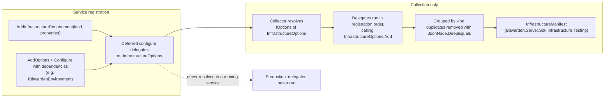

# Bitwarden.Server.Sdk.Infrastructure

Declarations of the infrastructure a service needs.

- `InfrastructureServiceCollectionExtensions` - `AddInfrastructureRequirement(kind, properties)` for declaring requirements
- `InfrastructureOptions` - Options holding the declared requirements as `JsonObject`s grouped by kind

## Design

### Flow

### Decisions

- A requirement is a kind plus a `JsonObject` of properties. There is no separate name or identity:
  within a kind the whole object is the identity, and `InfrastructureOptions.Add` skips a
  requirement when `JsonNode.DeepEquals` finds an equal one of the same kind. Requirements are never
  merged, so composite identities such as a topic and subscription need no encoding.
- Requirements are grouped by kind because readers such as chart generators work one kind at a
  time. Kinds are kept in ordinal order and requirements in declaration order within a kind, so a
  new requirement only changes its own kind's section of a saved manifest. The kind is not stored
  in the properties, so `kind` is not a reserved property name.
- `Requirements` is a read-only view over the live collections, so callers cannot add or remove
  requirements without going through `Add`.
- `Add` copies the properties it is given, so callers cannot change a requirement after declaring
  it and the same declaration can be collected more than once.
- Each `AddInfrastructureRequirement` call is a single `Configure<InfrastructureOptions>`
  registration. Nothing resolves `InfrastructureOptions` in a running service, so the configure
  delegates never run and the requirements are never created.
- `InfrastructureOptions` is public so libraries can use the options pattern directly, for example
  `Configure<TDep>` to decide at collection time whether a requirement exists.
- No well-known kinds are defined yet. Typed helpers that build the `JsonObject` for a kind can be
  added once kinds have stabilized, without changing the model.
