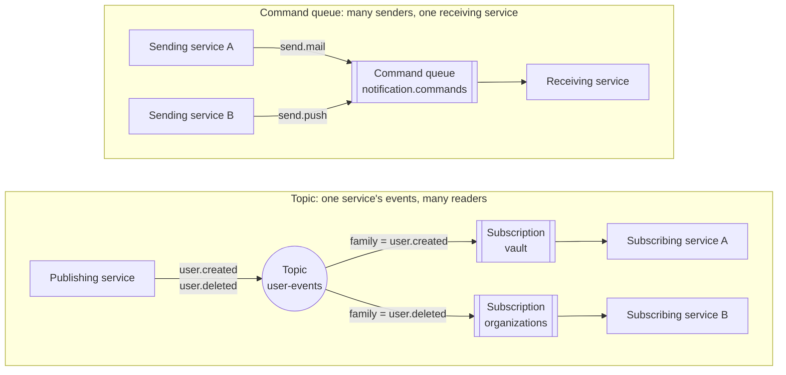
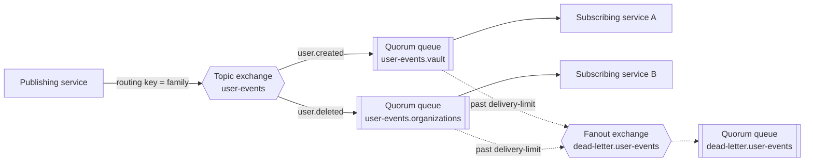
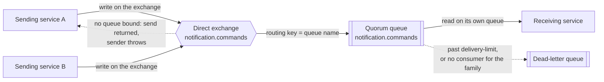

# Broker topology

**Audience:** Operators and platform engineers provisioning Azure Service Bus or RabbitMQ
infrastructure for services that use `Bitwarden.Server.Sdk.MessageBroker`. Application developers
can skip this document — the in-memory channel backend used during development needs no setup.

The library does not provision broker topology. The exchanges, queues, topics, subscriptions, and
related filters and policies must be declared on the broker before the application starts —
typically as part of the broker container's bootstrap or via infrastructure-as-code (Terraform,
Pulumi, broker-specific CLIs).

A broker topic carries messages from many payload families. Publishers stamp every outgoing message with
their family wire name (`IPayloadWireName<TPayload>.WireName`) so subscriptions can bind or filter
down to the family they consume.

The two shapes this document provisions, with generic services in place of real ones:



Every queue and subscription has a delivery limit. A message that reaches it, or that the
service sets aside, goes to a dead-letter queue rather than back to the service.

## Collecting a service's topology

Each registration declares what it needs through `Bitwarden.Server.Sdk.Infrastructure`, so the
topology can be collected from a service's startup (with `Bitwarden.Server.Sdk.Infrastructure.Testing`)
and provisioned from that list rather than written by hand. The kinds are constants on
`MessagingRequirements`:

| Kind                      | Declared by                | Properties                         | Provision                                                       |
| ------------------------- | -------------------------- | ---------------------------------- | --------------------------------------------------------------- |
| `messaging-topic`         | `AddPublisher`             | `topic`                            | The topic, owned by this service                                |
| `messaging-publish`       | `AddPublisher`             | `topic`, `family`                  | Send rights on the topic                                        |
| `messaging-subscription`  | `AddSubscriber` and the consumers built on it | `topic`, `subscription`, `family` | The subscription, filtered or bound to the family, and receive rights on it |
| `messaging-command-queue` | `AddCommandConsumer`       | `queue`                            | The queue, owned by this service, and receive rights on it      |
| `messaging-command-consume` | `AddCommandConsumer`     | `queue`, `family`                  | Nothing; lets provisioning check senders against what the queue accepts |
| `messaging-command-send`  | `AddCommandSender`         | `queue`, `family`                  | Send rights on the receiving service's queue (on RabbitMQ, write on the queue's own exchange) |

None of them carries a connection string or key.

Provisioning collects every service's list and checks it before granting anything:

- **One owner per topic and per queue.** Each topic appears under `messaging-topic`, and each queue
  under `messaging-command-queue`, for exactly one service. Fail if two services claim the same
  one: a non-owner could publish another service's events or read its commands.
- **One owner per subscription.** Each topic and subscription pair appears under
  `messaging-subscription` for exactly one service, and its topic has an owner under
  `messaging-topic`. Fail otherwise: two services on one subscription would take each other's
  messages.
- **No two declarations make the same broker object.** Fail if two declarations of any kinds produce
  the same broker name, dead-letter exchanges and queues included. On RabbitMQ everything shares one
  name space (a topic's exchange is `{topic}`, a subscription's queue `{topic}.{subscription}`, a
  command queue and its exchange both `{queue}`), so the subscription `vault` on the topic
  `notification` and the command queue `notification.vault` would be the same queue.
- **Send rights only where declared.** Grant send rights on a topic only to its owner, and on a
  queue only to the services that declare `messaging-command-send` for it.
- **Senders match consumers.** Each `messaging-command-send` should name a family the queue's owner
  declares under `messaging-command-consume`; a command nobody consumes is dead-lettered at runtime.

## Azure Service Bus

For each unique `topic` passed to `AddPublisher<TPayload, TCeiling>(topic)`:

- A topic named `{topic}`.

For each `AddSubscriber<TPayload, TCeiling>(topic, subscription)`:

- A subscription named `{subscription}` on that topic with a Correlation filter on
  `x-bw-payload-family = '{WireName}'` so only `TPayload`'s family reaches this subscription.
  Set `MaxDeliveryCount` on the subscription as a backstop on redelivery, at least the largest
  `ConsumerRetryOptions.MaxDeliveries` its consumer is configured with; the subscription's
  built-in dead-letter queue handles exhausted or explicitly dead-lettered messages automatically.

If the Correlation filter is missing or wrong, the subscriber still falls back safely. It reads
the `x-bw-payload-family` application property on every message and dead-letters any message whose
family isn't `TPayload.WireName` before deserializing it, with a reason that names both families.
The filter is still the right production configuration, because it moves routing off the
subscriber and into the broker.

The library creates and owns its own `ServiceBusClient` from the configured connection string or namespace
and does not consume any `ServiceBusClient` the app registers separately. An app that also uses
`ServiceBusClient` against the same namespace will have two AMQP connections to the broker.

### Command queues

For each unique `queue` passed to `AddCommandConsumer<TPayload, TCeiling, TConsumer>(queue)`:

- A queue named `{queue}`, owned by the receiving service, with no filter. Set `MaxDeliveryCount`
  as for a subscription.

Senders (`AddCommandSender`) need only send rights on the queue.

### Access with a managed identity

A service configured with `AzureServiceBusFullyQualifiedNamespace` authenticates as the credential it
registers under `MessageBrokerKeys.Credential`, typically its managed identity. Grant it Azure's data roles at the narrowest scope that works: **Azure Service Bus Data
Sender** on each topic it publishes to and each command queue it sends to, and **Azure Service Bus
Data Receiver** on each of its own subscriptions and on its own command queue. No other service
needs receive rights on them.

## RabbitMQ

For each unique `topic` passed to `AddPublisher<TPayload, TCeiling>(topic)`:

- A durable **topic** exchange named `{topic}`.

For each `AddSubscriber<TPayload, TCeiling>(topic, subscription)`:

- A durable quorum queue named `{topic}.{subscription}`, bound to the topic exchange with
  routing key `{WireName}` (the `IPayloadWireName<TPayload>.WireName` of the family the
  subscriber consumes).
- A server-side policy applying `delivery-limit` to the queue, capping the number of
  redelivery attempts before a message is dead-lettered.
- A server-side policy applying `dead-letter-exchange`, `dead-letter-strategy: at-least-once`,
  and `overflow: reject-publish` to the queue, plus the target dead-letter exchange and a
  quorum queue bound to it.

If the queue's routing-key binding is wrong, the subscriber falls back to the same defensive
check — it reads the `x-bw-payload-family` header and dead-letters mismatches. The routing-key
binding is still the right production configuration because it moves the filter into the broker.

A hosted consumer ends its own retries after `ConsumerRetryOptions.MaxDeliveries` (see PACKAGE.md).
The delivery limit is the backstop, so set it at least as high as the largest `MaxDeliveries`
configured for the queue. A consumer that returns a message for redelivery does so with `basic.reject`, which
RabbitMQ counts toward the limit and in the `x-delivery-count` header that becomes
`Envelope.DeliveryCount`.

Policies must be used rather than queue arguments because quorum queue arguments cannot be
changed on an existing queue. See the RabbitMQ documentation on
[quorum queue poison-message handling](https://www.rabbitmq.com/docs/quorum-queues#poison-message-handling)
and [policies](https://www.rabbitmq.com/docs/policies) for the full command reference, and
`management.load_definitions` for declarative bootstrap via a `definitions.json` file loaded
at broker startup.

### What RabbitMQ needs for one topic



### Example: a user service

A user service registers:

```csharp
services.AddPublisher<UserCreatedPayload, UserCreated>("user-events");
services.AddPublisher<UserDeletedPayload, UserDeleted>("user-events");
services.AddSubscriber<UserCreatedPayload, UserCreated>("user-events", "vault");
services.AddSubscriber<UserDeletedPayload, UserDeleted>("user-events", "organizations");
```

where `UserCreatedPayload.WireName` is `"user.created"` and `UserDeletedPayload.WireName` is
`"user.deleted"`. Declare the topology with `rabbitmqadmin` and `rabbitmqctl`:

```bash
# One topic exchange carries both families.
rabbitmqadmin exchanges declare --name "user-events" --type "topic" --durable true

# One queue per subscription, each bound with its family's wire name as routing key.
rabbitmqadmin queues declare --name "user-events.vault" --type "quorum" --durable true
rabbitmqadmin bindings declare --source "user-events" \
  --destination-type "queue" --destination "user-events.vault" --routing-key "user.created"

rabbitmqadmin queues declare --name "user-events.organizations" --type "quorum" --durable true
rabbitmqadmin bindings declare --source "user-events" \
  --destination-type "queue" --destination "user-events.organizations" --routing-key "user.deleted"

# Dead-letter exchange and queue. The names must not match the policy pattern
# below, which would otherwise re-apply the dead-letter policy to the dead-letter
# queue and cycle its messages back through itself.
rabbitmqadmin exchanges declare --name "dead-letter.user-events" --type "fanout" --durable true
rabbitmqadmin queues declare --name "dead-letter.user-events" --type "quorum" --durable true
rabbitmqadmin bindings declare --source "dead-letter.user-events" \
  --destination-type "queue" --destination "dead-letter.user-events"

# Policy applying delivery-limit, dead-letter-exchange, dead-letter-strategy, and
# overflow to the user-events.* subscription queues.
rabbitmqctl set_policy user-events-subscriptions "^user-events\." \
  '{"delivery-limit":10,"dead-letter-exchange":"dead-letter.user-events","dead-letter-strategy":"at-least-once","overflow":"reject-publish"}' \
  --apply-to quorum_queues
```

### Command queues (RabbitMQ)

For each unique `queue` passed to `AddCommandConsumer<TPayload, TCeiling, TConsumer>(queue)`:

- A durable **direct** exchange named `{queue}`.
- A durable quorum queue named `{queue}`, bound to that exchange with the queue's name as its
  routing key. Senders publish to the exchange with the same routing key.
- Apply the same `delivery-limit` and dead-letter policy as subscription queues.



Each command queue has its own exchange so that sending can be granted one queue at a time: a
sender's user needs `write` on `^{queue}$` for each queue it sends to, and the receiver's user
`read` on its own queue. The permissions are regular expressions, so escape the dots in a queue's
name (`^notification\.commands$`). Don't grant service users `write` on the default exchange
(`amq.default`): it reaches every queue in the virtual host.

